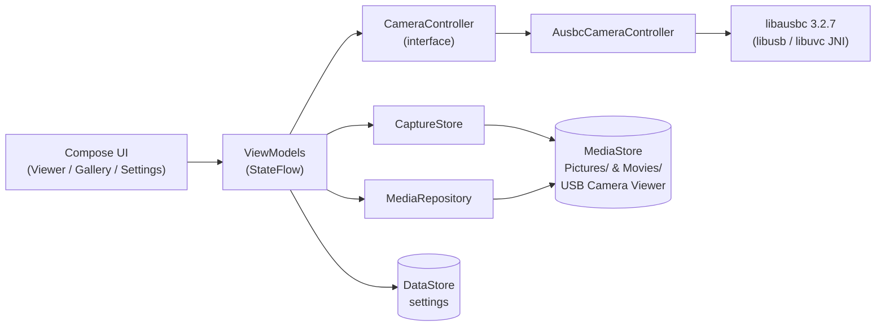

  

<h1 align="center">USB Camera Viewer</h1>

  Live view, capture, and browse USB (UVC) endoscopes and borescopes on Android — fully offline.
   <em>by muh</em>

<!-- Update muh/usbcameraviewer below after pushing this repo to GitHub. -->

  
  
  
  
  

## Features

- **Live preview** over USB-C OTG — the app offers to open automatically when a UVC camera is plugged in, and recovers from unplug/replug without a restart
- **Photo capture & MP4 video recording** (optional microphone audio) with a recording timer, capture flash + haptic feedback, and a low-storage guard
- **Hardware shutter button** — the physical button on the endoscope takes a photo
- **In-app gallery** — grid with video badges, pinch-zoom viewer, share, delete
- **Resolution picker, rotate & mirror** (preview transforms), keep-screen-on
- **Dark, camera-first UI** — Jetpack Compose + Material 3, edge-to-edge
- **Fully offline** — no INTERNET permission, no analytics, no ads (runtime permissions are Camera — which Android mandates for USB video — and, only if you enable audio, the microphone)

## Screenshots

<!-- Fill these after the on-device hardware pass: drop PNGs into docs/assets/screenshots/ -->
| Viewer | Gallery | Settings |
|---|---|---|
| _coming soon_ | _coming soon_ | _coming soon_ |

## Getting started

**You need:** an Android 8.0+ (API 26) phone with USB host (OTG) support, and a UVC-class USB camera — most inexpensive USB endoscopes/borescopes are UVC.

**Install** — either grab `usb-camera-viewer-<tag>.apk` from the
[latest release](https://github.com/muh/usbcameraviewer/releases/latest), or build it yourself:

    ./build.sh debug --install

**First run:** plug the camera into the phone (USB-C, or via an OTG adapter) → Android asks to open USB Camera Viewer → grant the **Camera** permission (Android requires it to access any USB video device) → tap Allow on the USB permission dialog → live picture.

## Usage

- **Viewer** — shutter button takes a photo; toggle to video mode to record (timer chip shows elapsed time). Resolution chip opens the mode picker; rotate cycles 90° steps; mirror flips the preview.
- **Gallery** — tap the thumbnail shortcut. Pinch to zoom photos, tap play on videos (opens your system player), share or delete from the top bar.
- **Settings** — startup resolution policy, video quality (currently no effect — see Known limitations), filename prefix, keep-screen-on, open-source licenses.

## Troubleshooting

| Problem | Check |
|---|---|
| "Plug in your camera" never changes | Phone must support USB host/OTG (the app tells you if it doesn't). Try a data-capable cable/adapter, not charge-only. |
| No permission dialog after replug | Unplug, wait a second, replug; or tap **Grant permission** on the permission screen. |
| Stuck on "Connecting…" forever | The Camera permission was denied. Grant it in Android Settings → Apps → USB Camera Viewer → Permissions; Android blocks USB video access without it. |
| Camera opens but no picture | Some non-UVC cameras enumerate but aren't supported — verify the camera is UVC-class. |
| Videos have no sound | By design — see Known limitations. |

## Build & development

    ./build.sh debug              # debug APK
    ./build.sh release            # release APK (signed if keystore configured)
    ./build.sh release --gates    # run test/detekt/ktlint/lint first
    ./build.sh debug --install    # build + adb install

Built APKs are collected into `dist/` (git-ignored) as
`usb-camera-viewer-<version>-<variant>[-unsigned].apk`.

Quality gates: `./gradlew test detekt ktlintCheck lint`.

**Release signing** (optional — builds are unsigned without it): create `keystore.properties` at the repo root (git-ignored):

    storeFile=/path/to/release.jks
    storePassword=...
    keyAlias=...
    keyPassword=...

`build.sh` also picks up global `ANDROID_KEYSTORE`, `ANDROID_KEYSTORE_PASS`,
`ANDROID_KEY_ALIAS`, `ANDROID_KEY_PASS` environment variables (e.g. from your
shell profile) when no `keystore.properties`/`UCV_*` vars are set.

**CI releases:** pushing a tag matching `v*` (e.g. `git tag v1.0.0 && git push origin v1.0.0`) runs the quality gates and attaches `usb-camera-viewer-<tag>.apk` to a GitHub Release. For a *signed* CI APK add repository secrets:

| Secret | Value |
|---|---|
| `KEYSTORE_B64` | `base64 -w0 release.jks` |
| `KEYSTORE_PASSWORD` | keystore password |
| `KEY_ALIAS` | key alias |
| `KEY_PASSWORD` | key password |

Without secrets the workflow still succeeds and attaches an unsigned APK.

## Architecture

Single-module MVVM. Compose UI observes `StateFlow` from ViewModels; all UVC access is isolated behind a `CameraController` interface.

`libausbc` is pinned to **3.2.7** — newer 3.3.x artifacts are broken on JitPack (missing transitive AARs). Only `AusbcCameraController` touches the library, so it can be swapped without touching features. Package map: `camera/` (UVC), `capture/` (files + MediaStore), `viewer/`, `gallery/`, `settings/`, `navigation/`, `ui/theme/`.

## Hardware testing

Unit tests fake the camera; real UVC behavior needs a device. Run [docs/hardware-test-checklist.md](docs/hardware-test-checklist.md) on a physical phone with an endoscope before shipping a release — the checklist in this repo is an unrun template until then.

## Known limitations

- **Capture is frame-based** — the pinned camera library's own photo/video writers require `WRITE_EXTERNAL_STORAGE` (ungrantable on Android 13+), so photos and videos are encoded from the preview frames (TextureView bitmap → JPEG; MediaCodec H.264 + optional AAC audio → MediaMuxer). Recording follows the current preview resolution.
- **Effective resolution depends on the camera** — the picker lists the sizes the device advertises, but some cheap endoscopes negotiate a fixed stream (often 640×480) regardless; selecting another size restarts the stream but the device may keep its own.
- **Rotate/mirror affect the preview only** — captured photos/videos keep the sensor orientation.
- **Single camera** — with multiple UVC devices attached, only the most recently attached one is used; there is no chooser.
- A 512 px Play Store icon export is not generated (vector-only sources); render the launcher vectors at 512 px when needed.

## Contributing

PRs welcome once the repo is public: keep `./gradlew test detekt ktlintCheck lint` green, follow conventional commits, and note any hardware you verified against.

## License

[MIT](LICENSE) © 2026 muh. Bundled third-party components (AUSBC — Apache-2.0, libuvc — BSD-3-Clause, libusb — LGPL-2.1, Coil, AndroidX, Kotlin — Apache-2.0) are listed with full texts in-app under **Settings → Open-source licenses**.
