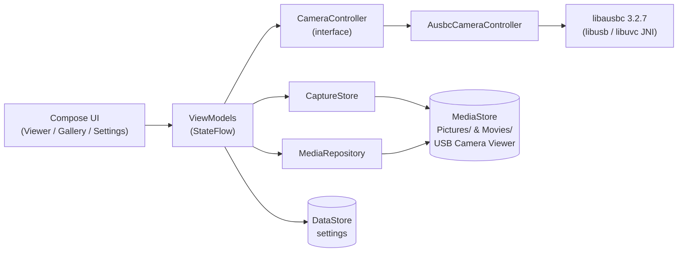

# README Showcase Implementation Plan

> **For agentic workers:** REQUIRED SUB-SKILL: Use superpowers:subagent-driven-development (recommended) or superpowers:executing-plans to implement this plan task-by-task. Steps use checkbox (`- [ ]`) syntax for tracking.

**Goal:** Showcase-grade README with SVG logo, badges, install/usage/troubleshooting docs, mermaid architecture diagram, plus MIT LICENSE file.

**Architecture:** Pure docs/assets change — no app code. Logo SVG mirrors the launcher-icon vector geometry. README is a full rewrite that must stay truthful to the implemented app (video-only recording, preview-only transforms, single device, libausbc 3.2.7, offline).

**Tech Stack:** SVG, GitHub-flavored Markdown, mermaid, shields.io badge URLs.

## Global Constraints

- Repo/org path in badge URLs: `muh/usbcameraviewer` placeholder + HTML comment to update after first GitHub push
- README claims must match code truth: video-only recording; rotate/mirror preview-only; single UVC device; libausbc 3.2.7 pinned; no INTERNET permission; minSdk 26
- License: MIT, copyright `2026 muh`
- Logo geometry mirrors launcher vectors: bezel r30→r22 gradient `#C4E7FF`→`#4FA8DD`; aperture r22→r16 `#16232D`; pupil r16 radial `#2E6E96`→`#081520`; glint center (49,47) r4.5 `#E8F6FF`; background radial `#152430`→`#0B0F12`
- Commit per task; trailer `Co-Authored-By: Claude Fable 5 <noreply@anthropic.com>`

---

### Task 1: Logo SVG + LICENSE + screenshots dir

**Files:**
- Create: `docs/assets/logo.svg`
- Create: `docs/assets/screenshots/.gitkeep`
- Create: `LICENSE`

**Interfaces:**
- Consumes: nothing
- Produces: `docs/assets/logo.svg` (README header), `LICENSE` (README License section links it), `docs/assets/screenshots/` (README screenshot table points into it)

- [ ] **Step 1: Create logo SVG**

`docs/assets/logo.svg`:
```xml
<svg xmlns="http://www.w3.org/2000/svg" viewBox="0 0 108 108" width="108" height="108">
  <defs>
    <radialGradient id="bg" cx="50%" cy="42.6%" r="72.2%">
      <stop offset="0%" stop-color="#152430"/>
      <stop offset="100%" stop-color="#0B0F12"/>
    </radialGradient>
    <linearGradient id="bezel" x1="34" y1="28" x2="76" y2="82" gradientUnits="userSpaceOnUse">
      <stop offset="0%" stop-color="#C4E7FF"/>
      <stop offset="100%" stop-color="#4FA8DD"/>
    </linearGradient>
    <radialGradient id="pupil" cx="49" cy="45" r="24" gradientUnits="userSpaceOnUse">
      <stop offset="0%" stop-color="#2E6E96"/>
      <stop offset="100%" stop-color="#081520"/>
    </radialGradient>
  </defs>
  <rect x="0" y="0" width="108" height="108" rx="24" fill="url(#bg)"/>
  <path fill="url(#bezel)" fill-rule="evenodd"
        d="M54,24a30,30 0 1,0 0,60a30,30 0 1,0 0,-60zM54,32a22,22 0 1,1 0,44a22,22 0 1,1 0,-44z"/>
  <path fill="#16232D" fill-rule="evenodd"
        d="M54,32a22,22 0 1,0 0,44a22,22 0 1,0 0,-44zM54,38a16,16 0 1,1 0,32a16,16 0 1,1 0,-32z"/>
  <path fill="url(#pupil)" d="M54,38a16,16 0 1,0 0,32a16,16 0 1,0 0,-32z"/>
  <circle cx="49" cy="47" r="4.5" fill="#E8F6FF" fill-opacity="0.92"/>
</svg>
```

- [ ] **Step 2: Screenshots dir placeholder**

```bash
mkdir -p docs/assets/screenshots
touch docs/assets/screenshots/.gitkeep
```

- [ ] **Step 3: LICENSE (MIT)**

`LICENSE`:
```
MIT License

Copyright (c) 2026 muh

Permission is hereby granted, free of charge, to any person obtaining a copy
of this software and associated documentation files (the "Software"), to deal
in the Software without restriction, including without limitation the rights
to use, copy, modify, merge, publish, distribute, sublicense, and/or sell
copies of the Software, and to permit persons to whom the Software is
furnished to do so, subject to the following conditions:

The above copyright notice and this permission notice shall be included in all
copies or substantial portions of the Software.

THE SOFTWARE IS PROVIDED "AS IS", WITHOUT WARRANTY OF ANY KIND, EXPRESS OR
IMPLIED, INCLUDING BUT NOT LIMITED TO THE WARRANTIES OF MERCHANTABILITY,
FITNESS FOR A PARTICULAR PURPOSE AND NONINFRINGEMENT. IN NO EVENT SHALL THE
AUTHORS OR COPYRIGHT HOLDERS BE LIABLE FOR ANY CLAIM, DAMAGES OR OTHER
LIABILITY, WHETHER IN AN ACTION OF CONTRACT, TORT OR OTHERWISE, ARISING FROM,
OUT OF OR IN CONNECTION WITH THE SOFTWARE OR THE USE OR OTHER DEALINGS IN THE
SOFTWARE.
```

- [ ] **Step 4: Verify**

Run: `python3 -c "import xml.dom.minidom;xml.dom.minidom.parse('docs/assets/logo.svg');print('svg ok')"`
Expected: `svg ok`.

- [ ] **Step 5: Commit**

```bash
git add -A
git commit -m "feat: README logo asset, MIT license, screenshots directory"
```

---

### Task 2: README full rewrite

**Files:**
- Modify: `README.md` (complete replacement)

**Interfaces:**
- Consumes: `docs/assets/logo.svg`, `LICENSE`, `docs/assets/screenshots/` (Task 1)
- Produces: final README

- [ ] **Step 1: Replace README.md with exactly this content**

````markdown
<p align="center">
  
</p>

<h1 align="center">USB Camera Viewer</h1>

<p align="center">
  Live view, capture, and browse USB (UVC) endoscopes and borescopes on Android — fully offline.
  <br><em>by muh</em>
</p>

<!-- Update muh/usbcameraviewer below after pushing this repo to GitHub. -->
<p align="center">
  <a href="https://github.com/muh/usbcameraviewer/actions/workflows/release.yml"></a>
  <a href="https://github.com/muh/usbcameraviewer/releases/latest"></a>
  <a href="LICENSE"></a>
  
  
</p>

## Features

- **Live preview** over USB-C OTG — the app offers to open automatically when a UVC camera is plugged in, and recovers from unplug/replug without a restart
- **Photo capture & MP4 video recording** with a recording timer and low-storage guard
- **In-app gallery** — grid with video badges, pinch-zoom viewer, share, delete
- **Resolution picker, rotate & mirror** (preview transforms), keep-screen-on
- **Dark, camera-first UI** — Jetpack Compose + Material 3, edge-to-edge
- **Fully offline** — no INTERNET permission, no analytics, no ads

## Screenshots

<!-- Fill these after the on-device hardware pass: drop PNGs into docs/assets/screenshots/ -->
| Viewer | Gallery | Settings |
|---|---|---|
| _coming soon_ | _coming soon_ | _coming soon_ |

## Getting started

**You need:** an Android 8.0+ (API 26) phone with USB host (OTG) support, and a UVC-class USB camera — most inexpensive USB endoscopes/borescopes are UVC.

**Install** — either grab `usb-camera-viewer-<tag>.apk` from the
[latest release](https://github.com/muh/usbcameraviewer/releases/latest), or build it yourself:

    ./build.sh debug --install

**First run:** plug the camera into the phone (USB-C, or via an OTG adapter) → Android asks to open USB Camera Viewer → tap Allow on the USB permission dialog → live picture.

## Usage

- **Viewer** — shutter button takes a photo; toggle to video mode to record (timer chip shows elapsed time). Resolution chip opens the mode picker; rotate cycles 90° steps; mirror flips the preview.
- **Gallery** — tap the thumbnail shortcut. Pinch to zoom photos, tap play on videos (opens your system player), share or delete from the top bar.
- **Settings** — startup resolution policy, video quality, filename prefix, keep-screen-on, open-source licenses.

## Troubleshooting

| Problem | Check |
|---|---|
| "Plug in your camera" never changes | Phone must support USB host/OTG (the app tells you if it doesn't). Try a data-capable cable/adapter, not charge-only. |
| No permission dialog after replug | Unplug, wait a second, replug; or tap **Grant permission** on the permission screen. |
| Camera opens but no picture | Some non-UVC cameras enumerate but aren't supported — verify the camera is UVC-class. |
| Videos have no sound | By design — see Known limitations. |

## Build & development

    ./build.sh debug              # debug APK
    ./build.sh release            # release APK (signed if keystore configured)
    ./build.sh release --gates    # run test/detekt/ktlint/lint first
    ./build.sh debug --install    # build + adb install

Quality gates: `./gradlew test detekt ktlintCheck lint`.

**Release signing** (optional — builds are unsigned without it): create `keystore.properties` at the repo root (git-ignored):

    storeFile=/path/to/release.jks
    storePassword=...
    keyAlias=...
    keyPassword=...

**CI releases:** pushing a tag matching `v*` (e.g. `git tag v1.0.0 && git push origin v1.0.0`) runs the quality gates and attaches `usb-camera-viewer-<tag>.apk` to a GitHub Release. For a *signed* CI APK add repository secrets:

| Secret | Value |
|---|---|
| `KEYSTORE_B64` | `base64 -w0 release.jks` |
| `KEYSTORE_PASSWORD` | keystore password |
| `KEY_ALIAS` | key alias |
| `KEY_PASSWORD` | key password |

Without secrets the workflow still succeeds and attaches an unsigned APK.

## Architecture

Single-module MVVM. Compose UI observes `StateFlow` from ViewModels; all UVC access is isolated behind a `CameraController` interface.



`libausbc` is pinned to **3.2.7** — newer 3.3.x artifacts are broken on JitPack (missing transitive AARs). Only `AusbcCameraController` touches the library, so it can be swapped without touching features. Package map: `camera/` (UVC), `capture/` (files + MediaStore), `viewer/`, `gallery/`, `settings/`, `navigation/`, `ui/theme/`.

## Hardware testing

Unit tests fake the camera; real UVC behavior needs a device. Run [docs/hardware-test-checklist.md](docs/hardware-test-checklist.md) on a physical phone with an endoscope before shipping a release — the checklist in this repo is an unrun template until then.

## Known limitations

- **Video records without audio** — the pinned camera library's recorder has no audio/bitrate support; the app records video-only and never requests the microphone permission.
- **Rotate/mirror affect the preview only** — captured photos/videos keep the sensor orientation.
- **Single camera** — with multiple UVC devices attached, the first one wins; there is no chooser.
- **No shutter flash animation** — the gallery thumbnail update is the capture feedback.
- A 512 px Play Store icon export is not generated (vector-only sources); render the launcher vectors at 512 px when needed.

## Contributing

PRs welcome once the repo is public: keep `./gradlew test detekt ktlintCheck lint` green, follow conventional commits, and note any hardware you verified against.

## License

[MIT](LICENSE) © 2026 muh. Bundled third-party components (AUSBC — Apache-2.0, libuvc — BSD-3-Clause, libusb — LGPL-2.1, Coil, AndroidX, Kotlin — Apache-2.0) are listed with full texts in-app under **Settings → Open-source licenses**.
````

- [ ] **Step 2: Truthfulness pass**

Re-read the final README against these facts (grep the codebase if unsure): video-only recording, preview-only rotate/mirror, single device, libausbc 3.2.7, minSdk 26, no INTERNET permission, MediaStore album "USB Camera Viewer", build.sh flags, secret names. Fix any drift.

- [ ] **Step 3: Verify links/anchors**

Run: `python3 - <<'EOF'
import re,os
md=open('README.md').read()
for m in re.finditer(r'\]\((?!http)([^)#]+)\)',md):
    p=m.group(1)
    assert os.path.exists(p), f'broken relative link: {p}'
print('links ok')
EOF`
Expected: `links ok`.

- [ ] **Step 4: Commit**

```bash
git add README.md
git commit -m "docs: showcase README with logo, badges, usage, architecture"
```

## Plan Self-Review Notes

- Spec §1 → Task 1 step 1 + README header; §2 → Task 1 step 3 + License section; §3 items 1-12 → README sections in order. No gaps.
- Badge URLs use `muh/usbcameraviewer` placeholder + comment per Global Constraints.
- README states no-mic-permission (matches post-final-review code), video-only, 3.2.7 pin — truth-checked in Task 2 step 2.
